

# 김태희 · TaeHui Kim

### 직접 운영하며, 사용자가 머무는 흐름을 설계합니다

**[Antony Studio](https://antonystudio.kr) CEO** 
경북대학교 글로벌소프트웨어융합전공 · 카카오테크캠퍼스 4기

사용자가 어디서 머물고 어디서 떠나는지 운영하며 확인하고, 그 흐름을 화면과 경험으로 다시 설계하는 Product Engineer입니다.

 

---

## About Me

제대로 동작하지 않던 병원 홈페이지를 고치고 싶어 웹을 시작했고, 
그 사이트를 수년간 직접 운영하며 **만든 것이 실제로 쓰일 때의 감각**을 배웠습니다.

지금은 이 세 가지를 기준으로 일합니다.

- **첫 30초를 먼저 설계합니다.** 처음 들어온 사용자가 무엇을 보고 무엇을 누르는지부터 그립니다.
- **운영하며 고칩니다.** 지표와 실제 반응을 보고 화면을 다듬고, 고친 이유를 기록합니다.
- **끝까지 맡습니다.** 기획과 구현에서 멈추지 않고 출시, 운영, 개선까지 책임집니다.

### Now

| | |
| --- | --- |
| 🐜 **Antony Studio** | 토스 주식 투자 게임 「개미 투자자 키우기」 1인 개발, 출시, 운영 |
| 💉 **백신알리미+** | 부모님 예방접종을 가족과 보건소가 함께 챙기는 GovTech 우수상 수상 서비스 (CTO) |
| 📇 **Gitory** | 커밋과 PR을 경험 카드와 자소서로 잇는 서비스 (FE 리드) |
| 🔧 **Reqover** | 2026 오픈소스 개발자대회 동상, Spring 요청 추적 오픈소스 |

[Antony Studio](#antony-studio) · [백신알리미+](#dodal) · [Gitory](#gitory) · [Reqover](#reqover) · [TUG GUARD](#tugguard) · [Members Clinic](#members) · [GROOVE](#groove) · [크누타운 · LAN Kit](#knu-town) · [금융 AI](#kb) · [Medirole](#medirole)

---

# 🏢 Antony Studio

게임과 AI 제품을 만들고 직접 운영하는 1인 스튜디오 · CEO · 2026.09 개업

### 🐜 개미 투자자 키우기

출근으로 종잣돈을 모으고, 가상 주식에 투자해 개미를 키우는 게임입니다. 
Apps in Toss에 출시해 **신규 게임, 시뮬레이션 분야 1위**에 올랐습니다.

| 누적 이용자 | D1 리텐션 | D7 리텐션 | 유료 결제 |
| :---: | :---: | :---: | :---: |
| **66,069명** | **46.51%** | **32.34%** | **676건** |

누적 이용자 2026.11.26 기준, 나머지 2026.10.13 기준 · Threads 519,443회 조회

  

  &nbsp;&nbsp;&nbsp;
  

- **성장 루프:** 출근 → 투자 → 진화 → 꾸미기로 이어지며 다시 접속할 이유를 만들었습니다.
- **운영:** 사용자 반응을 보며 첫 실행, 튜토리얼, 화면 안정성을 계속 다듬습니다.
- **개발:** 공통 웹 게임과 플랫폼별 어댑터, 저장과 복구 흐름을 구현했습니다.

[게임 소개](https://antonystudio.kr/games/ant-investor/) · [앤토니 스튜디오](https://antonystudio.kr)

구현과 운영 상세

- 튜토리얼 문장 중복 출력, 이미지 로딩과 첫 플레이의 경합, PC와 모바일 화면 충돌을 재현해 고치고 회귀 검사 기록을 남겼습니다.
- HTML, CSS, JavaScript 공통 게임과 플랫폼별 어댑터를 분리하고, AI 생성 아트 후보를 실제 화면에서 검수해 최종 자산을 골랐습니다.

---

# Projects

## 1. 💉 백신알리미+ — 2026 GovTech 우수상

팀 도달(DODAL) · AI Tech Lead(CTO) · 2026 GovTech 우수상 · 강릉시 실증 MVP

부모님 예방접종을 **보호자, 부모님, 보건소가 함께** 챙기는 서비스입니다.

  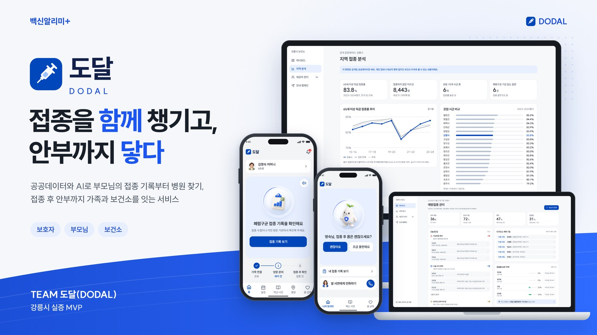

- **세 사용자, 세 화면:** 보호자, 부모님(큰 글씨와 음성), 보건소 화면을 각각 설계하고 혼자 구현했습니다.
- **데이터로 찾은 문제:** 공공데이터로 **미접종 어르신 8,443명**과 **접종 기관 없는 읍면 6곳**을 찾았습니다.
- **답하지 않는 AI:** 근거가 없으면 답하지 않는 상담 흐름으로 평가 33문항을 통과했습니다.

보건소 대시보드, 병원 찾기, 구현 상세

  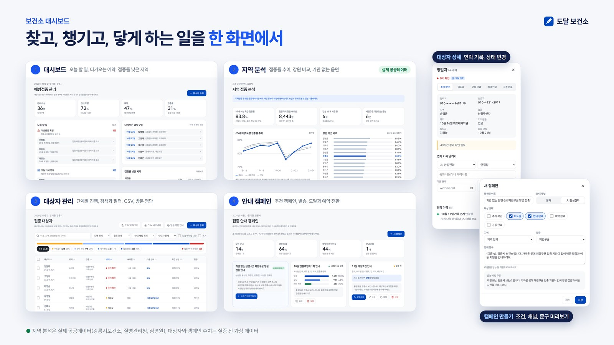

  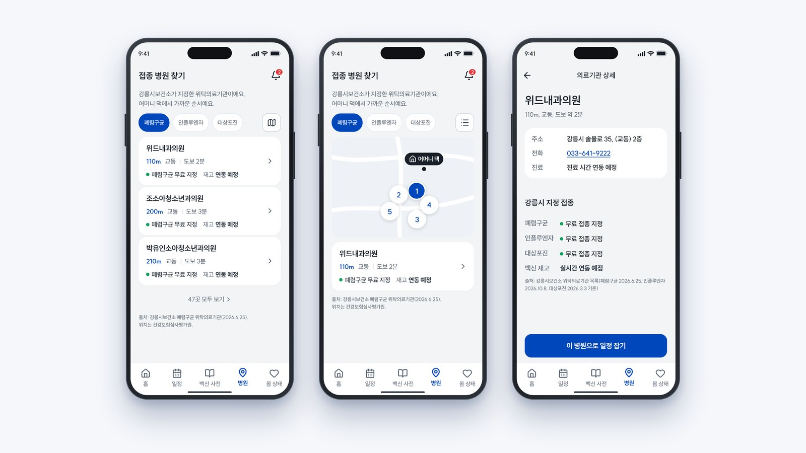

- 강릉시보건소 위탁의료기관 74곳을 수집해 건강보험심사평가원 병원정보서비스 API로 좌표와 요양기호를 모두 매칭했습니다. 질병관리청 시군구 접종 통계로 미접종 규모를 계산했습니다.
- AI 상담은 응급 규칙 → 판단 거절 → 답변 은행 → BM25 검색 → Gemini 근거 답변 순서로 흐릅니다. 공개 서버에서는 체험 코드로 API 키를 보호합니다.
- 두 휴대폰이 한 가족으로 묶이도록 FastAPI 서버에 낙관적 버전 동기화와 웹 푸시를 붙였습니다.
- 기술: React, TypeScript, FastAPI, PostgreSQL, Gemini, 심평원과 질병관리청 공공데이터

---

## 2. 📇 Gitory

카카오테크캠퍼스 4기 경북대 1팀 · FE 리드 · 운영 서비스

GitHub 커밋과 PR을 **근거가 연결된 경험 카드**로 바꾸고, 공고 매칭과 자소서 초안까지 잇는 서비스입니다.

  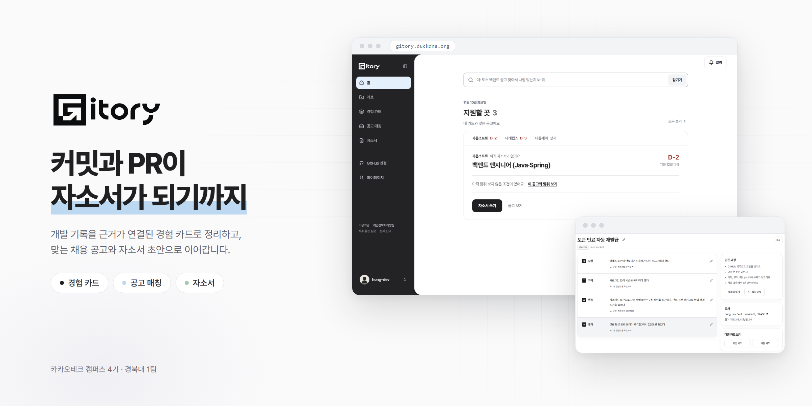

- **네 걸음 흐름:** 저장소 고르기 → 경험 카드 → 공고 매칭 → 자소서로 이어지게 설계했습니다.
- **확인할 수 있는 AI:** AI는 판단만 하고, 근거와 수치는 코드가 검사합니다. 빈칸이 남은 카드는 확정하지 않습니다.
- **FE 리드:** 라우팅, 서버 상태(TanStack Query), API 계약(zod), 샘플 모드와 E2E를 맡았습니다.

흐름 화면, 경험 카드 초안, 품질 관리

  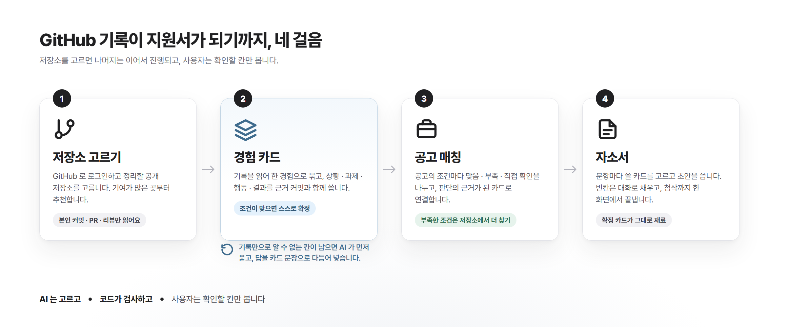

  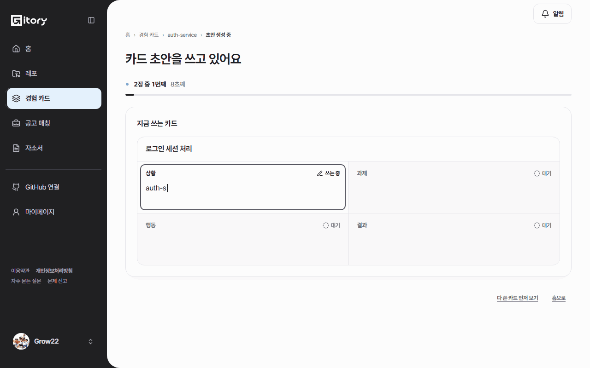

- 팀 전체로 화면 단위 테스트 약 1,800개, 화면 E2E 378개를 두고 CI 4개가 모두 통과해야 배포합니다. 배포 확인에 실패하면 자동으로 롤백합니다.
- 기술: React, TypeScript, TanStack Query, Spring Boot, FastAPI, Playwright

---

## 3. 🔧 Reqover — 2026 오픈소스 개발자대회 동상

Spring 요청별 실행 관계 분석 · 2인 오픈소스 팀 · 핵심 MVP 설계와 구현

“이 API 요청이 실제로 어떤 코드를 실행했을까?”에 답하는 도구입니다.

  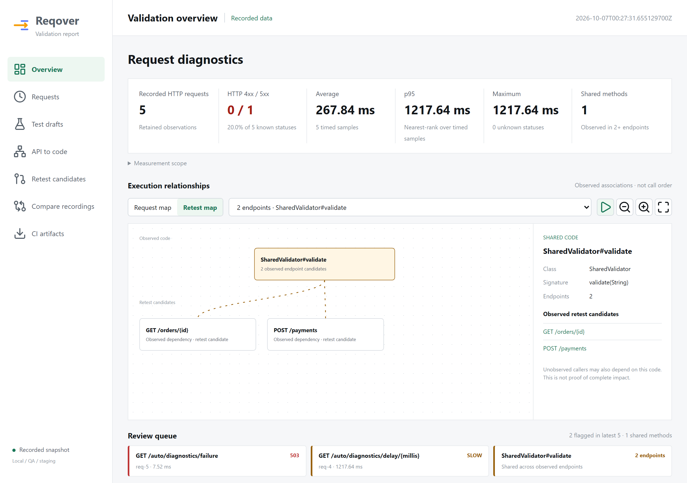

- **문제:** 커버리지로는 “어떤 요청이 이 코드를 실행했는지” 알기 어려웠습니다.
- **내 구현:** 요청별 실행 기록, ASM 계측, Java Agent, 코드 → API 역방향 인덱스를 만들었습니다.
- **지금:** Maven Central 배포, 오프라인 대시보드, PR에 재확인할 API를 남기는 GitHub Action까지 확장했습니다.

[저장소](https://github.com/reqover-labs/reqover) · [2분 데모 영상](https://youtu.be/N62BEzVchSM) · [릴리스](https://github.com/reqover-labs/reqover/releases)

요청 진단, 요청별 리포트, 구현 상세

  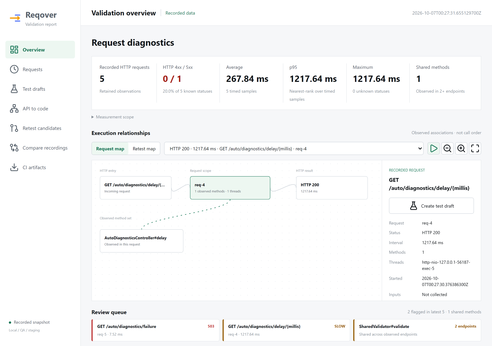

  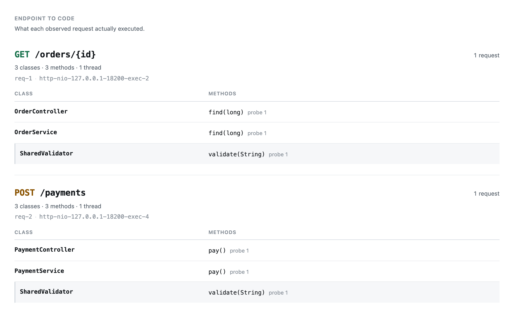

- **내 구현:** 요청별 실행 bucket과 probe 라우팅, ASM 메서드 진입 계측, `-javaagent` 패키징, API → 메서드 리포트와 코드 → API 역방향 인덱스, 별도 JVM 에이전트 검증과 데모.
- **팀의 확장:** Spring MVC/WebFlux 어댑터를 함께 개선했고, 팀은 JSON 내보내기, CLI `render`·`diff`·`impact`, GitHub Action, 0.4 대시보드(요청 진단, 녹화 비교, 테스트 초안)로 확장했습니다.
- **0.4.2:** 라이브러리는 Maven Central, 에이전트와 CLI는 GitHub Releases로 배포합니다. 요청별 상태와 지연 통계(p95), 녹화 비교, 관측 요청 기반 테스트 초안을 제공합니다.
- **범위:** 개발, QA, 스테이징용 초기 릴리스입니다. 줄과 분기 커버리지 도구(JaCoCo)와 함께 쓰도록 설계했습니다.

---

## 4. ⚓ TUG GUARD

해양 안전 디지털 트윈 · Three.js · 비전 학습 데이터 · FastAPI

예인 시나리오를 3D로 재현하고, 학습 데이터 생성부터 비전 추론과 위험 판단까지 연결했습니다.

  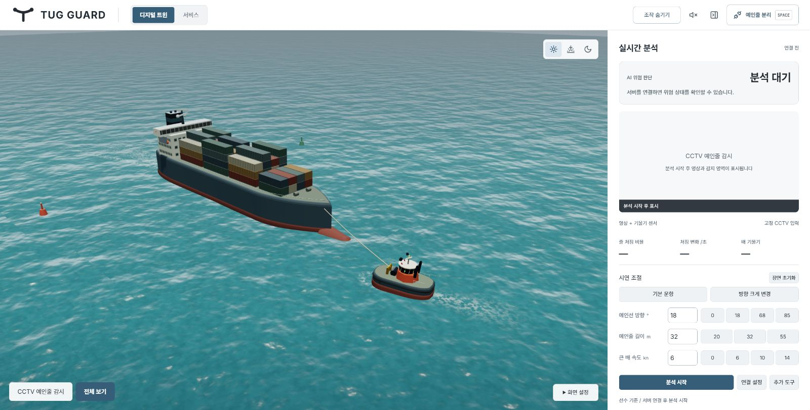

- **시뮬레이터:** 본선, 예인선, 예인줄을 조작하며 방향, 줄 길이, 속력, 시간대를 바꿔 재현합니다.
- **데이터 생성:** RGB 이미지, 픽셀 마스크, YOLO-Seg 라벨을 렌더 지오메트리에서 만듭니다.
- **위험 판단:** 팀의 학습 모델을 연결해 줄 처짐 변화와 횡경사를 함께 평가합니다.

[저장소](https://github.com/ShipTugging/tugboat-safety-twin) · [시뮬레이터](https://tugboat-safety-twin.vercel.app/)

학습 데이터, 추론 연동, 검증 상세

- **학습 데이터:** 예인줄 Sag 단계와 시점, 조명, 해상 조건을 바꿔 생성했습니다. 가려진 줄은 마스크에서 제외했습니다.
- **멀티모달 기록:** 하나의 시뮬레이션 시계로 24 FPS 영상과 100 Hz 합성 IMU를 기록하고 정합성을 검사했습니다.
- **AI 연동:** 팀이 학습한 예인줄 분할 모델을 FastAPI 분석 서버에 연결해 마스크 품질, 줄 처짐, 영상 각도와 IMU 횡경사로 경보 상태를 계산했습니다.
- **범위:** 모델 학습과 평가는 팀 작업이며, 실선 사고 데이터로 검증한 안전 인증 시스템은 아닙니다.

---

## 5. 🏥 Members Clinic — 첫 웹사이트에서 운영 서비스까지

1인 기획, 디자인, 개발, 운영 · Next.js 재구축

웹을 시작하게 만든 병원 홈페이지를 직접 제안해 만들고, 수년간 운영하며 다시 만들었습니다.

  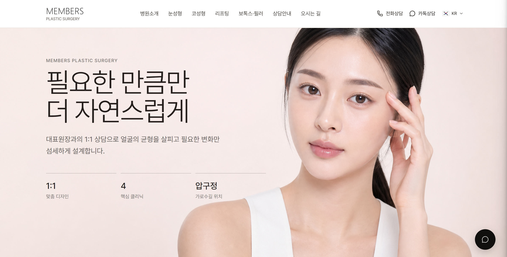

| 지표 | 기존 | Next.js 운영 버전 |
| --- | :---: | :---: |
| 전송 용량 | 10,420KB | **2,567KB** (약 75% 감소) |
| SEO | 92 | **100** |

- **우선순위:** 복잡한 예약 기능보다 검색되는 콘텐츠, 상담 접근성, 낮은 운영 부담을 먼저 골랐습니다.
- **검색 노출:** 메타데이터, sitemap, 의료와 FAQ 구조화 데이터를 적용했습니다.

측정 상세와 기술

| 지표 | 기존 HTML/CSS/JS | Next.js 운영 버전 | 변화 |
| --- | :---: | :---: | :---: |
| 총 전송 용량 | 10,420KB | **2,567KB** | 약 75% 감소 |
| SEO | 92 | **100** | +8 |
| Performance | **94** | 89 | −5 |
| LCP | **1.6초** | 2.2초 | +0.6초 |

같은 Lighthouse 데스크톱 프리셋으로 측정했고, 성능 수치가 내려간 부분은 다음 최적화의 기준으로 남겼습니다. 
기술: Next.js 16, React 19, TypeScript, Tailwind CSS 4

---

## 6. 🛍️ MERCI — JSP와 Servlet으로 만든 쇼핑몰

백엔드 기본기 · 주문 트랜잭션 · 최우수 평가와 장학금

  

- **처음부터 끝까지:** 상품, 장바구니, PG 테스트 결제, 카카오 로그인, 관리자 기능까지 커머스 흐름을 완성했습니다.
- **주문 정합성:** 주문 생성과 재고 차감을 한 트랜잭션으로 묶고, 초과 판매를 막았습니다.
- **결과:** Java 2,127줄, JSP 56개 규모로 완성해 **최우수 평가와 장학금**을 받았습니다.

상품 상세, 주문 화면, 구현 상세

  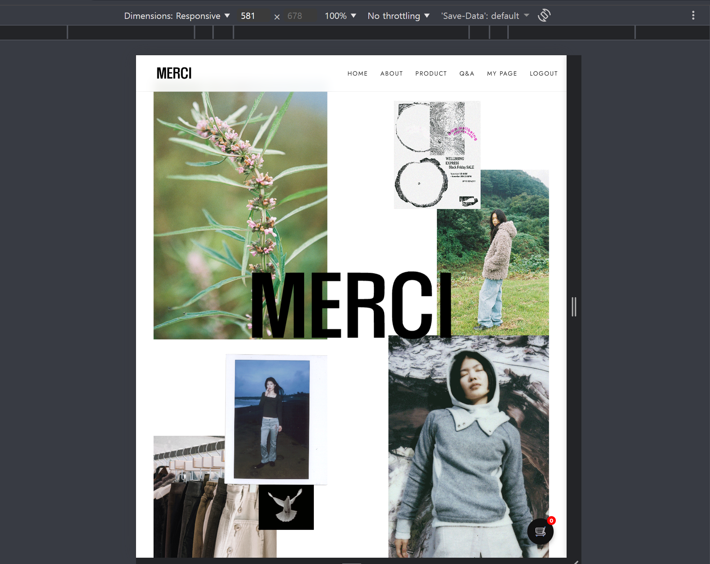

  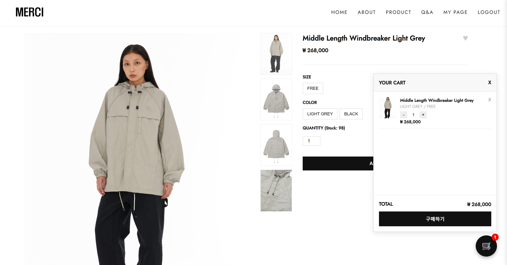

- JSP, Servlet, JDBC, MySQL로 요청, 세션, 인증과 DB 반영 흐름을 직접 구현했습니다.
- 실패하면 rollback하고, `WHERE stock >= ?` 조건으로 초과 판매를 차단했습니다.
- DAO 9개, 모델 10개, 처리 컨트롤러 22개.

---

## 7. 🎪 GROOVE — 경북대 6개 단과대학 연합축제

기획 참여 · 주막 지도와 QR 주문 백엔드 · 2026.10.01–10.02

직접 주막을 운영하며 본 병목을 **QR 주문과 입금 확인 흐름**으로 바꿨습니다.

  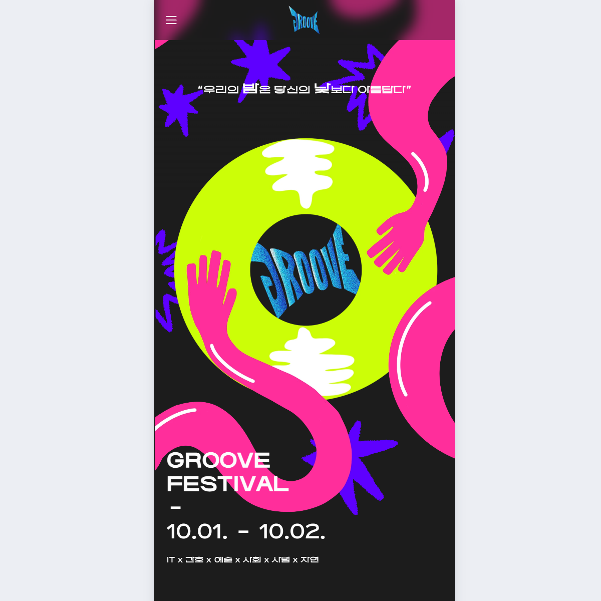

- **현장에서 찾은 문제:** 손님이 입금 화면을 보여주고 직원이 테이블을 돌던 흐름이 병목이었습니다.
- **바꾼 흐름:** QR 주문 → 입금자명 제출 → 관리자 확인 → 조리와 서빙을 한곳에서 보게 했습니다.
- **규모:** 참여 단과대학 재학생 8,937명, 주막 22곳의 지도와 주문 API를 만들었습니다.

[축제 웹사이트](https://chcse.knu.ac.kr/groove/) · [팀 프론트엔드 저장소](https://github.com/groove-festival/groove-client)

주문 정합성, 운영 경험, 검증 상세

- **운영 경험:** 컴퓨터학부 주막 운영 인원 39명과 메뉴, 가격, 매출, 주방과 서빙 동선을 함께 관리했습니다. 전적 대학에서 3일간 총매출 약 1,700만 원의 주막 운영에 참여한 경험도 적용했습니다.
- **중복 방지:** 같은 멱등 키의 재요청에는 최초 주문 결과를 돌려주고, 메뉴명과 금액을 주문 당시 값으로 보관했습니다.
- **상태 정합성:** 입금자명 수정과 승인, 승인과 취소가 동시에 들어오는 상황을 조건부 UPDATE와 비관적 락으로 처리했습니다.
- **검증:** 병합 PR 기준 전체 35개 테스트와 주막 관련 통합, 동시성 시나리오 19개 통과를 확인했습니다.
- **범위:** 메인 화면을 포함한 프론트엔드는 팀 결과물입니다. 8,937명은 재학생 규모이며 실제 이용자 수가 아닙니다. 출처: [경북대학교 2026 통계연보](https://ir.knu.ac.kr/state/report.php?isc_no=2081&isg_no=54)

---

## 8. 🏎️ AWS DeepRacer — Physical AI 경진대회 최우수상

강화학습 전략 · 보상 함수 · 실차 튜닝

  

- **빠른 검증:** 가설 10개, 모델 약 50개를 병렬로 돌려 학습 병목을 줄였습니다.
- **실패 분석:** 시뮬레이터에서 빠르던 정책이 실차에서 이탈한 원인을 카메라 지연에서 찾았습니다.
- **결과:** 중앙선 추종과 구간별 속도 제어로 바꿔 **경북대 × 전남대 Physical AI 경진대회 최우수상**을 받았습니다.

---

## 9. 🛡️ KB 안심보이스 — 시니어 금융 Agentic AI

2026 KB AI Challenge · 팀 프로젝트

  

- **누구를 위해:** 시니어가 말과 글로 금융 업무를 요청하는 에이전트입니다.
- **권한 분리:** LLM은 이해와 설명만 하고, 실행 여부는 규칙과 서버 코드가 판단합니다.
- **안전장치:** 중요한 거래는 사용자 규칙과 **일회용 승인 토큰**을 모두 통과해야 실행됩니다.

[공개 저장소와 구현 기록](https://github.com/TaeHuiKKIM/kb-ansimvoice)

---

## 10. 💼 CrossCheck — 공시 근거 대조 Agent

미래에셋증권 AI Festival · RiskTwin 기획의 구현 · HyperCLOVA X · NCP 배포

여러 공시를 찾아 비교하고 계산한 뒤, **모든 결론을 원문 근거와 다시 대조**하는 Agent입니다.

  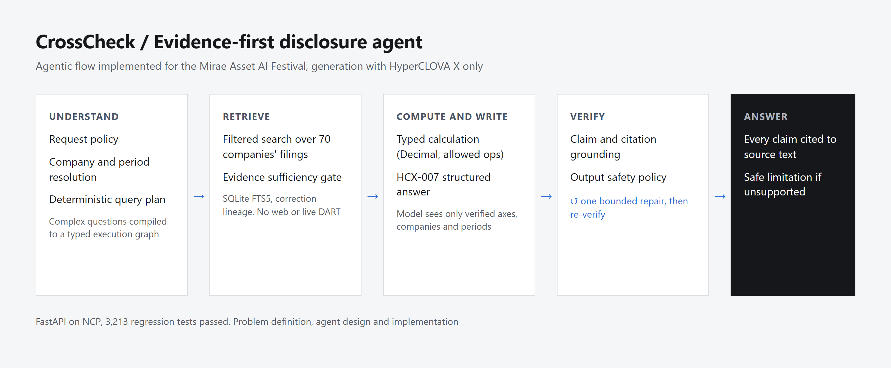

- **근거 우선:** 근거가 부족하면 단정하지 않고 한계를 답합니다.
- **닫힌 데이터:** 주최 측 70개 기업 공시만 쓰고 웹과 실시간 공시는 쓰지 않습니다.
- **검증:** FastAPI 공개 API를 NCP에 배포했고 회귀 테스트 3,213개를 통과했습니다.

Agent 흐름 상세

- 질문 정책 → 기업과 기간 해석 → 결정론적 계획 → 필터 검색(SQLite FTS5) → 근거 충분성 확인 → 타입 계산(Decimal) → HCX-007 구조화 답변 → 주장과 인용 근거 대조 → 1회 제한 수정.
- 복합 질문은 Typed Evidence Execution Graph로 컴파일합니다.
- 7월에 기획한 RiskTwin(추천, 반대 검토, 적합성 판단, 근거 검증 4개 역할)을 공시 Agent로 직접 구현했습니다. 문제 정의부터 설계, 구현, 배포까지 맡았습니다.

---

## 11. 🩺 Medirole — AI 표준화환자 플랫폼

실시간 문진 · 자동 채점 · CODE-MEDI 해커톤 최우수상

의료인의 CPX(임상수행시험) 대비를 위한 AI 표준화환자입니다.

  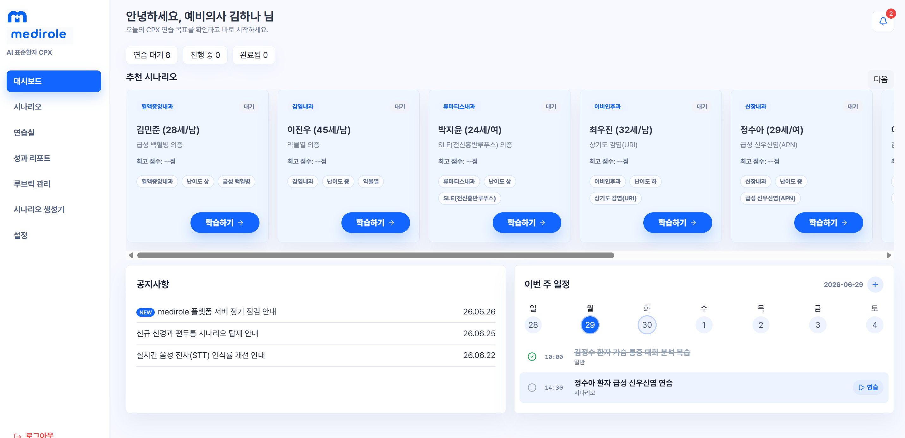

- **실시간 문진:** FastAPI WebSocket으로 음성과 텍스트 문진을 구현했습니다.
- **진짜 시험처럼:** 정확히 질문해야 정보를 알려주는 환자와 12분 제한을 설계했습니다.
- **자동 채점:** 40개 체크리스트를 복원하고, 채점이 실패해도 대화 기록을 잃지 않게 했습니다.

문진 화면과 평가 리포트

  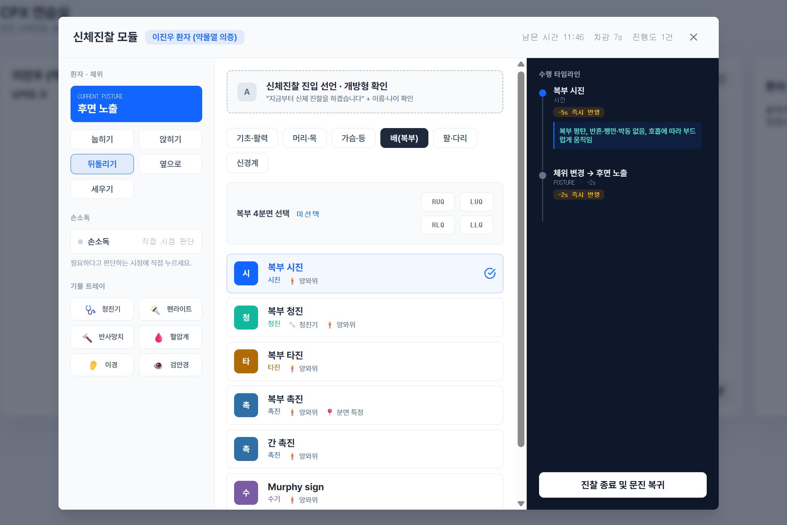

  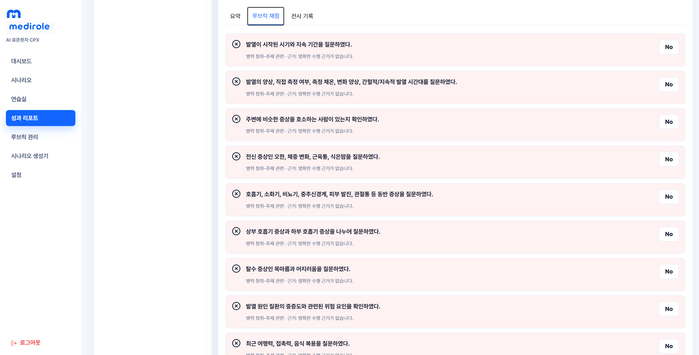

기술: React, FastAPI, WebSocket, Supabase, Gemini Structured Output, Docker

---

## 12. 🏫 크누타운 & Campus LAN Kit — 캠퍼스 멀티플레이와 로컬 통신

노트북 호스트 · HTTP POST / SSE · 브라우저 멀티플레이 · 오픈소스 MIT

같은 학교 Wi-Fi에서 친구와 만나고 공부하는 **캠퍼스 멀티플레이 게임**을 만들고, 통신 구조를 다른 프로젝트에서도 쓸 수 있는 **로컬 통신 키트**로 분리했습니다.

  

- **크누타운:** 이동·채팅·도서관 착석·공부 기록·옷장을 연결하고, 휴대폰과 노트북이 같은 방에서 플레이하도록 구현했습니다.
- **현장에서 해결:** 같은 Wi-Fi인데도 접속되지 않던 문제를 주소 대역과 호스트 방화벽 허용 범위로 나눠 확인했습니다. 교내 실험에서 팀원 3명의 통신을 확인했습니다.
- **Campus LAN Kit:** 방·세션·이동·채팅·재접속을 서버 코어와 브라우저 클라이언트로 분리했습니다. **외부 의존성 없이** Node.js로 실행하며, 사용자 정의 게임 상태를 붙일 수 있습니다.
- **전달 비용 줄이기:** 행동은 POST로 받고 변경 상태는 SSE로 전달합니다. 연속 이동을 묶고, 바뀐 상태를 중심으로 전송하도록 개선했습니다.

[크누타운 웹 광장](https://knu-direct-plaza.vercel.app/?mode=web) · [게임 저장소](https://github.com/TaeHuiKKIM/knu-town-community) · [로컬 통신 키트](https://github.com/TaeHuiKKIM/campus-lan-kit)

통신 구조와 검증 범위

- 키트의 `createHub`는 HTTP와 독립적으로 방·행동·구독을 처리하고, `createLanServer`가 JSON API와 SSE를 연결합니다. 방 격리, 입력·정원·빈도 제한, 입장 재시도와 세션 만료를 포함합니다.
- 크누타운은 별도 루프백 부하 검사에서 **모의 참가자 100명**의 입장·상태 전달·채팅과 만석 처리를 확인했습니다. 이는 현장 휴대폰 100대 검증과 구분합니다.
- 키트 공개판은 로컬 HTTP 클라이언트 3개와 데스크톱·모바일 브라우저로 이동·채팅·재접속을 확인했습니다. 교내망 실기기 재시험은 별도입니다.
- [교내망 실험과 부하 측정](https://github.com/TaeHuiKKIM/knu-town-community/blob/main/docs/network-research.md) · [키트 검증 기록](https://github.com/TaeHuiKKIM/campus-lan-kit/blob/main/docs/verification.md)

---

<strong>📦 More Products & Experiments</strong>

 

| 프로젝트 | 무엇을 | 기술 |
| --- | --- | --- |
| **🧭 Agent SEO Kit** | SEO 점검, 승인된 수정, 근거 기반 재검증을 분리 | Codex, Claude Code Agent Skills |
| **🗓️ 시간모아** | 로그인 없이 링크로 일정을 모으고 가능한 시간을 추천 | Next.js, Supabase |
| **📄 ReadmePDF** | 파일을 서버에 보내지 않고 브라우저에서 Markdown, PDF 처리 | Next.js, pdf-lib |
| **💤 Free-Tier Sleep** | 12일 해커톤 메타픽션 게임 | Unity, C# |
| **🧹 Photo Sweep** | 사진을 서버에 보내지 않는 Android 정리 앱 | Expo, React Native |
| **🎥 Virtual Face Cam** | OBS 기반 크로스플랫폼, macOS 네이티브 카메라 확장 | Python, SwiftUI |

[ReadmePDF](https://web-readme-pdf-free-mrgf3o4gbe0b862a.sel3.cloudtype.app/) · [Virtual Face Cam](https://github.com/TaeHuiKKIM/virtual-face-cam) · [Virtual Face Cam for macOS](https://github.com/TaeHuiKKIM/virtual-face-cam-mac)

---

## Tech Stack

| Area | Tools |
| --- | --- |
| **Product & Web** | TypeScript, React, Next.js, Tailwind CSS, Vite |
| **Backend & AI** | Python, FastAPI, Java, Spring Boot, Structured Output, WebSocket |
| **Data** | PostgreSQL, MySQL, SQLite, Supabase |
| **Ship & Test** | Vercel, Docker, GitHub Actions, Playwright, Vitest, Pytest |
| **More** | React Native, Expo, Unity, Three.js, SwiftUI |

## Awards

  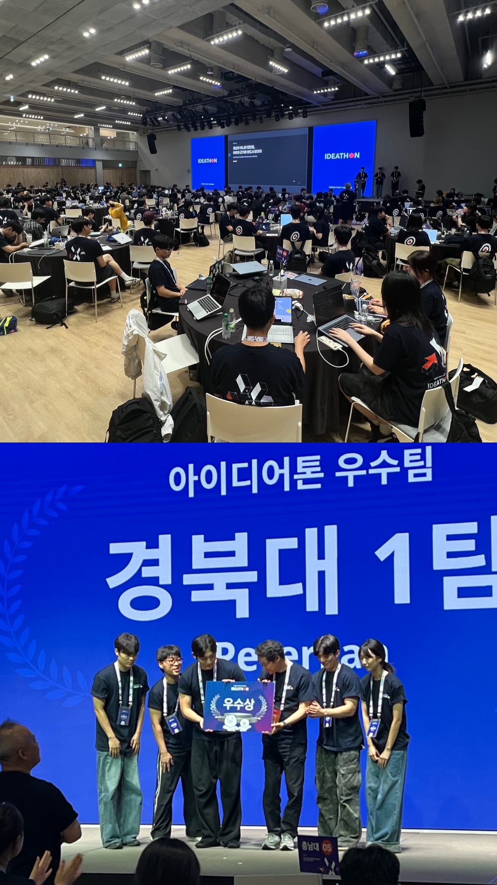

- 🏅 **2026 GovTech 우수상** — 백신알리미+ · 팀 도달(DODAL)
- 🥉 **2026 오픈소스 개발자대회 동상(후원기업상)** — Reqover 과학기술정보통신부 주최, 정보통신산업진흥원 주관
- 🏆 **2026 Physical AI 경진대회 최우수상** — AWS DeepRacer 경북대 × 전남대
- 🏆 **2026 CODE-MEDI 의료 AI, SW 융합 해커톤 최우수상** — Medirole 대한민국의학한림원
- 🏅 **2026 카카오테크캠퍼스 아이디어톤 우수상**
- 🏅 **2026 해달 해커톤 인기상** 경북대 IT대학 학술동아리 해달
- 🏅 **2025 TU 소프트웨어 경진대회 장려상**, **2025 시흥실록지리지 장려상** 한국공학대학교
- 🎓 백엔드 프로젝트 **최우수 평가와 장학금** — MERCI

## Activities

- **대구광역시 대학생 파견단, 중국 청두 미래산업 연수** · 대구 12개 대학 24명 선발 · 2026.11
- 카카오테크캠퍼스 4기 · IT 프로그래밍 동아리 해달
- 프로젝트마다 `docs/`에 기획, 설계, 문제 해결, 검증 근거를 남깁니다 → [kakaotech-learning-log](https://github.com/TaeHuiKKIM/kakaotech-learning-log)

